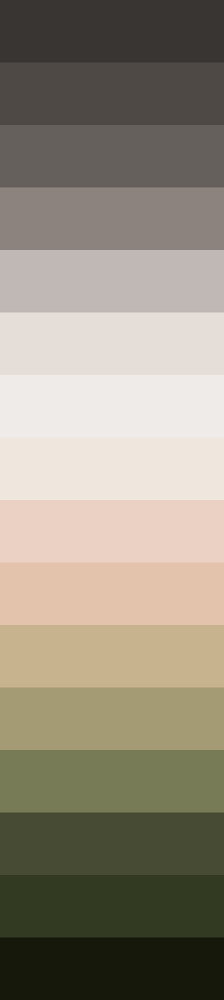

# Projeto desenvolvido no curso de UI&UX Design do [Origamid](https://www.origamid.com/curso/ui-design-para-iniciantes/)
### Refiz o design do curso para criar um exemplo de landing page para portfólio, onde me insiro como exemplo.

## Tech Stack:
* Figma;
* HTML;
* CSS.

## Design:
> Todo refeito com outra paleta de cores e uma arte produzida por mim para simular uma foto:
>>  
